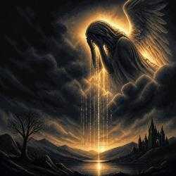
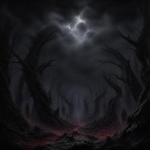

# OpenGameArt: music

**51 assets from [OpenGameArt](https://opengameart.org), dedicated to the public domain under [CC0](https://creativecommons.org/publicdomain/zero/1.0/).** Use them in any game, free or paid, and change them however you like; no credit is needed.

Music from OpenGameArt entries licensed CC0 (some also offer other licences; CC0 is the one that applies here). 847.8 MB in all.

This is a copy kept by [zuujis-cc0](https://github.com/zuujis-cc0) so game makers can take single files from GitHub. It is not made by or affiliated with OpenGameArt: the originals, often in more formats and higher resolutions, are on [opengameart.org](https://opengameart.org). If they help you, consider [supporting OpenGameArt](https://opengameart.org/content/faq).

Every file is listed in [MANIFEST.tsv](MANIFEST.tsv) with its size and SHA-256. More free assets: [the Zuujis collection](https://github.com/zuujis-cc0/free-game-assets#readme).

| | | | |
| :-: | :-: | :-: | :-: |
| <b><a href="%E2%80%9Cviolet%E2%80%9D">“Violet”</a></b> by Eldritch Grim · <a href="https://opengameart.org/content/%E2%80%9Cviolet%E2%80%9D">source</a> | <b><a href="100-victories-it-takes-a-hero-motivational-chips-day-2-zane-little-music-remixed">100 Victories & it takes a hero & motivational chips day 2 (Zane Little Music remixed)</a></b> by glitchart · <a href="https://opengameart.org/content/100-victories-it-takes-a-hero-motivational-chips-day-2-zane-little-music-remixed">source</a> | <b><a href="12-music-loops">12 Music Loops</a></b> by SubspaceAudio · <a href="https://opengameart.org/content/12-music-loops">source</a> | <b><a href="160bpm-electronic-loop">160BPM Electronic Loop</a></b> by RUOK · <a href="https://opengameart.org/content/160bpm-electronic-loop">source</a> |
| <b><a href="5-beepbox-musics">5 beepbox musics</a></b> by Hensji801 · <a href="https://opengameart.org/content/5-beepbox-musics">source</a> | <b><a href="5-trackssynth-hero-remake">[5 tracks]Synth Hero Remake</a></b> by MintoDog · <a href="https://opengameart.org/content/5-trackssynth-hero-remake">source</a> | <b><a href="8-bit-bluesy-battle-theme">8-Bit Bluesy Battle Theme</a></b> by emanresU · <a href="https://opengameart.org/content/8-bit-bluesy-battle-theme">source</a> | <b><a href="8-bit-concentration-loop">8 Bit Concentration Loop</a></b> by cosmac · <a href="https://opengameart.org/content/8-bit-concentration-loop">source</a> |
| <b><a href="8-bit-crisis">8-bit - Crisis!</a></b> by HydroGene · <a href="https://opengameart.org/content/8-bit-crisis">source</a> | <b><a href="8-bit-curious-theme">8-Bit Curious Theme</a></b> by emanresU · <a href="https://opengameart.org/content/8-bit-curious-theme">source</a> | <b><a href="8-bit-disco-loop">8 Bit Disco Loop</a></b> by cosmac · <a href="https://opengameart.org/content/8-bit-disco-loop">source</a> | <b><a href="8-bit-halloween-cavern-pico-8">8-bit Halloween Cavern (Pico-8)</a></b> by Pro Sensory · <a href="https://opengameart.org/content/8-bit-halloween-cavern-pico-8">source</a> |
| <b><a href="8-bit-i-am-not-clumsy">8-bit - I am not clumsy!</a></b> by HydroGene · <a href="https://opengameart.org/content/8-bit-i-am-not-clumsy">source</a> | <b><a href="8-bit-infinite-darkness">8-bit - Infinite Darkness</a></b> by HydroGene · <a href="https://opengameart.org/content/8-bit-infinite-darkness">source</a> | <b><a href="8-bit-jester-battle">8-bit - Jester Battle</a></b> by HydroGene · <a href="https://opengameart.org/content/8-bit-jester-battle">source</a> | <b><a href="8-bit-jester-theme">8-bit - Jester Theme</a></b> by HydroGene · <a href="https://opengameart.org/content/8-bit-jester-theme">source</a> |
| <b><a href="8-bit-jungle-music">8 bit jungle music</a></b> by game guy maker · <a href="https://opengameart.org/content/8-bit-jungle-music">source</a> | <b><a href="8-bit-last-mission">8-bit - Last Mission</a></b> by HydroGene · <a href="https://opengameart.org/content/8-bit-last-mission">source</a> | <b><a href="8-bit-lofi">8 Bit Lofi</a></b> by ThePixel · <a href="https://opengameart.org/content/8-bit-lofi">source</a> | <b><a href="8-bit-monstervania-2-0">8-bit MonsterVania #2</a></b> by HydroGene · <a href="https://opengameart.org/content/8-bit-monstervania-2-0">source</a> |
| <b><a href="8-bit-perilous-dungeon">8-bit - Perilous Dungeon</a></b> by HydroGene · <a href="https://opengameart.org/content/8-bit-perilous-dungeon">source</a> | <b><a href="8-bit-prairie">8 Bit Prairie</a></b> by Tarush Singhal · <a href="https://opengameart.org/content/8-bit-prairie">source</a> | <b><a href="8-bit-rush-point">8-bit - Rush Point</a></b> by HydroGene · <a href="https://opengameart.org/content/8-bit-rush-point">source</a> | <b><a href="8-bit-slay-the-evil">8-bit - Slay The Evil</a></b> by HydroGene · <a href="https://opengameart.org/content/8-bit-slay-the-evil">source</a> |
| <b><a href="8-bit-space-adventure-theme">8-Bit Space Adventure Theme</a></b> by emanresU · <a href="https://opengameart.org/content/8-bit-space-adventure-theme">source</a> | <b><a href="8-bit-summer-memory">8 bit summer memory</a></b> by Tarush Singhal · <a href="https://opengameart.org/content/8-bit-summer-memory">source</a> | <b><a href="8-bit-the-quiet-spy">8-bit - The Quiet Spy</a></b> by HydroGene · <a href="https://opengameart.org/content/8-bit-the-quiet-spy">source</a> | <b><a href="8-bit-title">8 bit Title</a></b> by ThePixel · <a href="https://opengameart.org/content/8-bit-title">source</a> |
| <b><a href="8-bit-truth">8-bit - Truth</a></b> by HydroGene · <a href="https://opengameart.org/content/8-bit-truth">source</a> | <b><a href="8-bit-unknown-planet">8-bit - Unknown Planet</a></b> by HydroGene · <a href="https://opengameart.org/content/8-bit-unknown-planet">source</a> | <b><a href="8bit-action-boss-battle">8bit Action Boss Battle</a></b> by MintoDog · <a href="https://opengameart.org/content/8bit-action-boss-battle">source</a> | <b><a href="8bit-action-jingle-mini-loop">8bit Action Jingle & Mini Loop</a></b> by MintoDog · <a href="https://opengameart.org/content/8bit-action-jingle-mini-loop">source</a> |
| <b><a href="8bit-action-miniboss-battle">8bit Action Miniboss Battle</a></b> by MintoDog · <a href="https://opengameart.org/content/8bit-action-miniboss-battle">source</a> | <b><a href="8bit-action-title">8bit Action Title</a></b> by MintoDog · <a href="https://opengameart.org/content/8bit-action-title">source</a> | <b><a href="8bitmusic">8BitMusic</a></b> by ThePixel · <a href="https://opengameart.org/content/8bitmusic">source</a> | <b><a href="a-dispirited-epic">A Dispirited Epic</a></b> by Eldritch Grim · <a href="https://opengameart.org/content/a-dispirited-epic">source</a> |
| <b><a href="we-drove-all-night-game-soundtrack">We Drove All Night - Game Soundtrack</a></b> by Holizna · <a href="https://opengameart.org/content/we-drove-all-night-game-soundtrack">source</a> | <b><a href="weasel-trot">Weasel Trot</a></b> by ShggothSlave · <a href="https://opengameart.org/content/weasel-trot">source</a> |  <b><a href="when-angels-cry">When Angels Cry</a></b> by Tsorthan Grove · <a href="https://opengameart.org/content/when-angels-cry">source</a> |  <b><a href="when-the-shadows-gather">When the Shadows Gather</a></b> by Tsorthan Grove · <a href="https://opengameart.org/content/when-the-shadows-gather">source</a> |
| <b><a href="when-we-were">When we were</a></b> by Grapestar · <a href="https://opengameart.org/content/when-we-were">source</a> | <b><a href="whispers-in-the-fog">Whispers in the Fog</a></b> by Ruhinre · <a href="https://opengameart.org/content/whispers-in-the-fog">source</a> | <b><a href="witch-kesiah">Witch Kesiah</a></b> by ShggothSlave · <a href="https://opengameart.org/content/witch-kesiah">source</a> | <b><a href="with-me-0">with me</a></b> by haruta · <a href="https://opengameart.org/content/with-me-0">source</a> |
| <b><a href="wolf-battle">Wolf Battle</a></b> by Guy G. Gamerson · <a href="https://opengameart.org/content/wolf-battle">source</a> | <b><a href="wonderful-world">wonderful world</a></b> by haruta · <a href="https://opengameart.org/content/wonderful-world">source</a> | <b><a href="wtf-its-the-big-bads-final-form">WTF its the big bads final form</a></b> by Fupi · <a href="https://opengameart.org/content/wtf-its-the-big-bads-final-form">source</a> | <b><a href="xenon-phoenix">Xenon Phoenix</a></b> by northivanastan · <a href="https://opengameart.org/content/xenon-phoenix">source</a> |
| <b><a href="ym2203-test-tune">YM2203 Test Tune</a></b> by Spring Spring · <a href="https://opengameart.org/content/ym2203-test-tune">source</a> | <b><a href="yoiyami-core-theme-%E2%80%93-deep-blue-ambient-piano">Yoiyami Core Theme – Deep Blue Ambient Piano</a></b> by Yoiyami · <a href="https://opengameart.org/content/yoiyami-core-theme-%E2%80%93-deep-blue-ambient-piano">source</a> | <b><a href="zodik-deep-choir">Zodik - Deep Choir</a></b> by Zodik · <a href="https://opengameart.org/content/zodik-deep-choir">source</a> |  |

---

Kept up to date by this repository's own [update workflow](.github/workflows/update.yml), with code and plan from [cc0-mirror](https://github.com/zuujis-cc0/cc0-mirror). Something wrong? [Open an issue there](https://github.com/zuujis-cc0/cc0-mirror/issues/new) or use the [private report form](https://games.zuujis.com/report).
